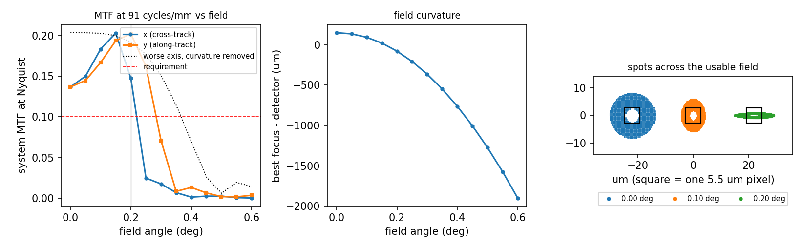

# Optical design: 30 cm telescope for 1 m ground sampling from 500 km

Every number here is produced by the scripts in this folder (`../run_all.sh` rebuilds them).

## 1. Requirements

From `requirements.py`. These are design choices for this study, not a real mission's numbers.

| Item | Value | Reason |
|---|---|---|
| Altitude | 500 km | common small-satellite EO orbit |
| Ground sample distance | 1.0 m | target product |
| Detector pixel | 5.5 um | TDI CMOS class (TBC) |
| Aperture | 0.30 m, 30% linear obscuration | small-satellite envelope |
| Band | 450-850 nm, design wavelength 650 nm | panchromatic |
| Image quality | system MTF at Nyquist >= 0.10 | optics x pixel |
| Radiometry | SNR >= 100, 30% reflectance, sun 30 deg from zenith | |

## 2. First-order design

GSD = H p / F gives the focal length; the aperture then fixes the f-number.

| Quantity | Value |
|---|---|
| Focal length | 2.750 m |
| f-number | 9.17 |
| Primary focal length / secondary magnification | 0.75 m / 3.667 |
| Detector Nyquist frequency | 90.9 cycles/mm |
| Optical cut-off 1/(lambda N) | 167.8 cycles/mm |
| Airy radius | 7.27 um |
| Q = lambda N / p | 1.08 (sampling close to Nyquist) |

## 3. Prescription

Ritchey-Chretien: both mirrors hyperbolic, chosen to cancel spherical aberration and coma.

| Surface | Shape | Radius (m) | Conic | Distance to next (m) | Clear diameter (m) |
|---|---|---|---|---|---|
| Primary | concave | 1.5000 | -1.0515 | 0.5571 | 0.300 |
| Secondary | convex | 0.5304 | -3.5831 | 0.5571 + 0.150 | 0.0771 (on axis) |

**Checking the ray tracer.** `raytrace.py` intersects each ray with each conic exactly. Two independent checks
(`design.py`): a near-axis ray focuses exactly at the design back focus with the design focal length; and the coma
of a classical Cassegrain traced at small fields, extrapolated to zero field, matches the third-order formula
3 theta / (16 N^2) to a ratio of 1.0010.

## 4. Image quality across the field

`performance.py` traces each field angle, computes the wavefront error on the reference sphere, the PSF by FFT,
and the MTF, then multiplies by the pixel MTF (0.637 at Nyquist). One flat detector is
placed -150 um from the paraxial focus, the position that gives the widest field
meeting the requirement.

| Field (deg) | RMS spot (um) | Strehl | MTF at Nyquist, x | MTF at Nyquist, y | Best focus vs detector (um) |
|---|---|---|---|---|---|
| 0.00 | 6.1 | 0.72 | 0.137 | 0.137 | +151 |
| 0.10 | 3.8 | 0.87 | 0.183 | 0.167 | +94 |
| 0.20 | 3.9 | 0.81 | 0.147 | 0.202 | -77 |
| 0.30 | 15.5 | 0.11 | 0.018 | 0.071 | -362 |
| 0.40 | 32.1 | 0.02 | 0.001 | 0.013 | -761 |
| 0.60 | 79.5 | 0.00 | 0.000 | 0.004 | -1899 |

**Finding.** With a flat detector the requirement holds out to 0.20 deg, a swath of
3.5 km. The limit is field curvature: the best-focus surface bends away from the flat
detector by more than a millimetre at the edge of a wider field. If a field-flattener lens (or a curved detector)
removed the curvature, astigmatism would become the limit at 0.35 deg,
a 6.1 km swath. So the design choice is: accept a 3.5 km
swath with two mirrors only, or add a refractive field corrector for about 6 km
(the corrector design is the next step and is not done here).

## 5. Tolerances on the secondary mirror

`tolerance.py` asks how large each error can be before the worst-case MTF over the usable field drops by 0.02,
with the detector refocused after assembly (the focus is a compensator).

| Error | Tolerance |
|---|---|
| Despace (along the axis) | +/-621 um (absorbed by refocusing; focus moves 14.44 x the despace) |
| Decentre (sideways) | +/-194 um |
| Tilt | +/-151 arcsec |

Monte Carlo of 150 builds with all three errors drawn uniformly within those tolerances: median worst-case MTF
0.123, 10th percentile 0.093; 84% of builds meet
the requirement without any adjustment beyond focus. The rest need the secondary adjusted during alignment (below).

## 6. Alignment plan

The sensitivities say what to adjust and what each symptom means.

1. **Primary to the mechanical axis.** Measure the primary's tilt with an autocollimator against the bulkhead reference.
2. **Secondary spacing.** Set with a gauge to well within the despace tolerance; fine focus comes later, at the detector
   (a 10 um spacing change moves the focus about 14 times as far).
3. **Remove coma on axis.** In double pass against a reference flat (interferometer at focus), or with a star test from a
   collimator: on-axis coma means the secondary is decentred or tilted. Adjust secondary tip/tilt until the on-axis image
   is symmetric.
4. **Detector focus.** Through-focus MTF scans with a slanted-edge target in a collimator at the centre and two field points;
   place the detector where the worst of the three is highest.
5. **Verify.** MTF at Nyquist at each field point against the requirement; record the as-built values.
6. **Thermal check.** Repeat step 4 at two temperatures; the drift must agree with `../mechanical/thermal_focus.py`.

## 7. Radiometry

`radiometry.py`: blackbody sun (which reproduces the 1361 W/m^2 solar constant), Lambertian ground, no atmosphere,
optics transmission 0.8 and quantum efficiency 0.6 (both TBC). The line time is 142 us and one
detector row collects 2748 electrons from the 30% target, SNR
52. Time-delay integration sums several rows looking at the same ground line:
**4 TDI stages** reach SNR >= 100 even when every stage adds its own read noise.
Adding the atmosphere (transmission below 1, path radiance) will change the count, which is why the TDI sensor should
offer more stages than this minimum.

## 8. Stray light (first look)

Paths to check in the next phase: direct sky light past the secondary onto the focal plane (needs a primary baffle tube
and a secondary baffle cone sized so the detector cannot see the sky directly); scatter from mirror roughness and
particles (BSDF of the coatings); and the bright Earth just outside the field. The usual figure of merit is the point
source transmittance against off-axis angle, from a non-sequential ray trace. Not done here.
